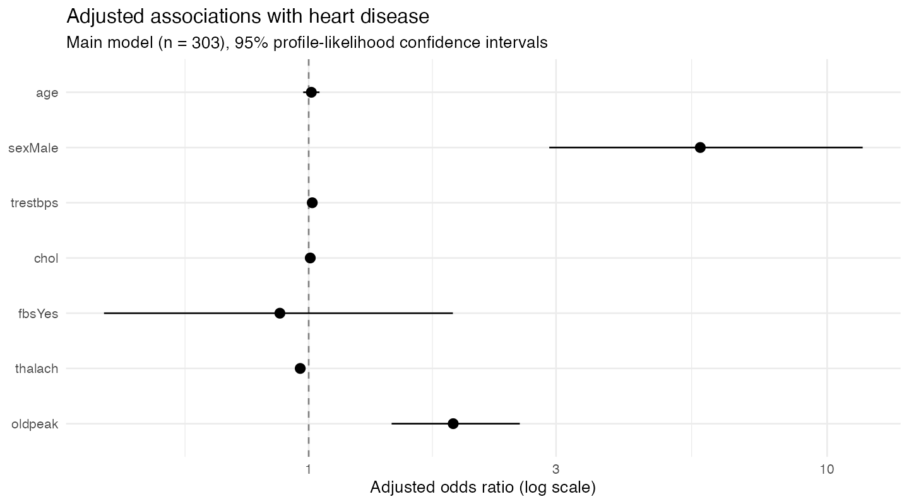
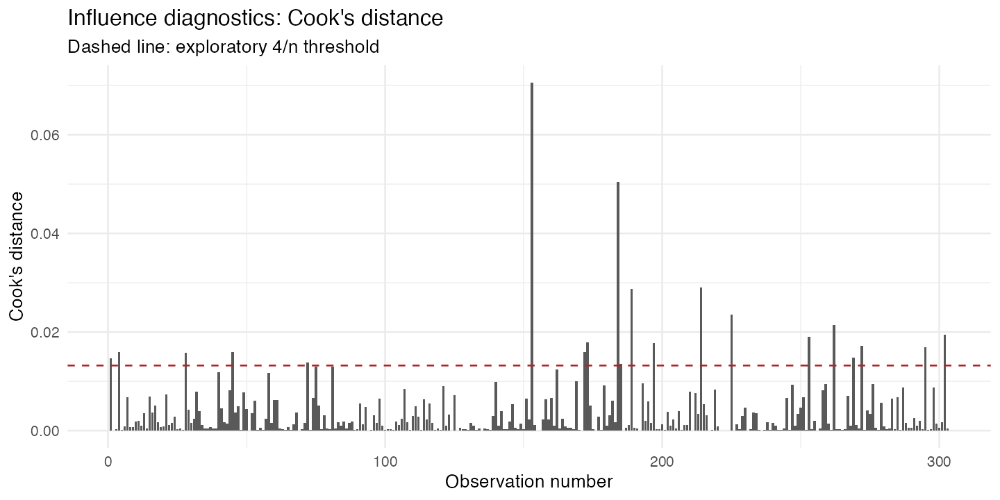
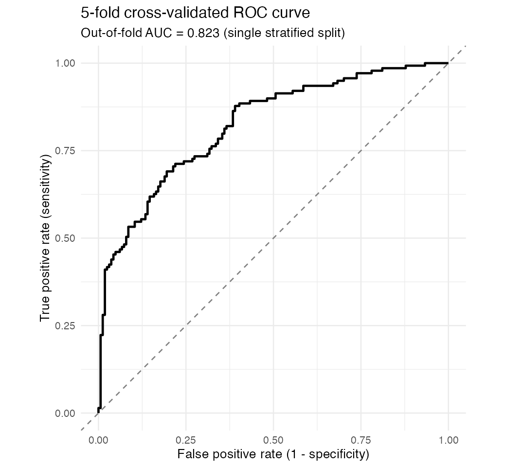

```{r setup, include=FALSE}
# Effectuer le rendu depuis la racine du projet.
# Le script source régénère tous les tableaux et graphiques intermédiaires.
stopifnot(file.exists("R/analysis.R"), file.exists("data/heart.csv"))
source("R/analysis.R", local = TRUE)
fmt <- function(x, digits = 3) formatC(x, digits = digits, format = "f")
```

> **Exercice de recherche réalisé dans le cadre d’un portfolio.** Il s’agit d’une analyse secondaire, documentée de manière indépendante, du jeu de données public UCI Cleveland Heart Disease. Ce travail n’est **ni un outil d’évaluation du risque clinique ni une étude causale**. Le jeu de données comprend 303 observations et est distribué par l’UCI Machine Learning Repository sous licence CC BY 4.0 ; les références figurent à la fin du rapport.

# Résumé

**Contexte.** Les données cardiovasculaires permettent d’illustrer l’utilisation de la régression logistique multivariable, l’interprétation des estimations d’association, les contrôles de qualité des données et la validation interne.

**Objectif.** Explorer les associations entre sept caractéristiques cliniques et la présence d’une maladie cardiovasculaire dans le jeu de données Cleveland, puis examiner la stabilité des estimations et la capacité discriminante apparente du modèle ajusté.

**Méthodes.** Le critère de jugement a été dichotomisé en absence de maladie (`target = 0`) ou présence de maladie (`target = 1–4`). Une régression logistique multivariable incluait l’âge, le sexe, la pression artérielle au repos, le cholestérol sérique, la catégorie de glycémie à jeun, la fréquence cardiaque maximale atteinte et le sous-décalage du segment ST induit par l’effort (`oldpeak`). Les odds ratios (OR) ajustés ont été présentés avec leurs intervalles de confiance à 95 % fondés sur le profil de vraisemblance. Les distances de Cook ont servi à une analyse de sensibilité *exploratoire*. La discrimination a été évaluée à l’aide de l’aire sous la courbe ROC (AUC) apparente et d’une validation croisée stratifiée unique à cinq plis.

**Résultats.** Le modèle principal comprenait `r nrow(heart_model)` observations, dont `r sum(heart_model$heart_disease == 1)` avec présence de maladie. Pour les hommes comparativement aux femmes, l’OR ajusté était de `r fmt(primary_or$OR[primary_or$variable == 'sexMale'],2)` (IC à 95 % : `r fmt(primary_or$CI95_low[primary_or$variable == 'sexMale'],2)`–`r fmt(primary_or$CI95_high[primary_or$variable == 'sexMale'],2)`). L’AUC apparente était de `r fmt(auc_apparent)` et l’AUC obtenue à partir des prédictions hors échantillon d’apprentissage était de `r fmt(auc_cv)`. L’exclusion des observations dépassant le seuil exploratoire de distance de Cook a modifié sensiblement plusieurs OR ajustés.

**Conclusion.** Cet exercice illustre l’utilisation et l’interprétation de la régression logistique. Toutefois, les résultats décrivent des associations, restent sensibles à certaines observations influentes et n’ont pas fait l’objet d’une validation externe.

# Contexte et objectifs

Le jeu de données Cleveland Heart Disease est fréquemment utilisé pour illustrer la classification et la modélisation statistique de données cliniques. Le critère de jugement d’origine comporte cinq catégories (0 à 4), souvent regroupées en un indicateur binaire : présence de maladie (1 à 4) ou absence de maladie (0). Le présent exercice vise à interpréter des **associations ajustées**, et non à établir des effets cliniques ou causaux.

La question étudiée est la suivante : *quelles caractéristiques des patients, parmi celles retenues, sont associées aux odds de présence d’une maladie cardiovasculaire après ajustement sur les autres caractéristiques incluses dans le modèle ?* Un objectif secondaire consiste à examiner l’apport des diagnostics d’influence et de la validation interne à l’interprétation.

# Données et préparation

## Source et critère de jugement

Source : **UCI Machine Learning Repository, Heart Disease (sous-ensemble Cleveland traité)**. Le fichier source comprend `r nrow(heart)` lignes et plusieurs attributs cliniques. Le fichier `heart.csv` présent dans ce dépôt est une version remise en forme avec des en-têtes de colonnes ; le codage original de `target` a été conservé.

Le critère de jugement binaire a été défini comme suit :

$$
Y_i = \begin{cases}
0, & \text{si } \mathrm{target}_i=0,\\
1, & \text{si } \mathrm{target}_i \in \{1,2,3,4\}.
\end{cases}
$$

```{r outcome-table}
knitr::kable(target_summary, col.names = c("Maladie cardiovasculaire (0 = absente, 1 = présente)", "Patients", "%"),
             caption = "Répartition du critère de jugement dans l’ensemble du jeu de données.")
```

## Contrôles de qualité des données

Les points d’interrogation présents dans les champs `ca` et `thal` d’origine ont été interprétés comme des valeurs manquantes. Ces deux variables totalisaient `r sum(quality$missing_n)` cellules manquantes ; le modèle retenu, comportant sept variables explicatives, n’utilisait **aucune** de ces deux variables. Les `r nrow(heart_model)` observations ont donc été conservées pour l’analyse principale. L’étape de préparation a également permis de vérifier les codages du critère de jugement et des variables catégorielles avant l’ajustement du modèle.

```{r missingness-table}
knitr::kable(subset(quality, missing_n > 0),
             col.names = c("Variable", "Valeurs manquantes"),
             caption = "Variables présentant des valeurs manquantes dans le jeu de données source.")
```

## Variables explicatives et unités d’interprétation

Les variables explicatives suivantes ont été retenues pour cet exercice pédagogique :

| Variable explicative | Représentation dans le modèle | Comparaison représentée par l’OR |
|:--|:--|:--|
| Âge (`age`) | Continue | Une année supplémentaire |
| Sexe (`sex`) | Catégorielle | Homme versus femme (référence) |
| Pression artérielle au repos (`trestbps`) | Continue | +1 mmHg |
| Cholestérol sérique (`chol`) | Continue | +1 mg/dL |
| Glycémie à jeun (`fbs`) | Catégorielle | Supérieure à 120 mg/dL versus non (référence) |
| Fréquence cardiaque maximale (`thalach`) | Continue | +1 battement/minute |
| Sous-décalage du segment ST induit par l’effort (`oldpeak`) | Continue | +1 unité |

Ces variables ont été sélectionnées pour proposer une démonstration interprétable et de taille raisonnable de la régression multivariable, et **non** selon un protocole clinique de sélection des variables formellement prédéfini. Les variables continues ont été modélisées selon une relation linéaire avec le logit ; cette hypothèse n’a pas été évaluée formellement dans cet exercice.

# Méthodes statistiques

## Régression logistique principale

Une régression logistique binaire multivariable a été ajustée à l’aide de la famille binomiale et de la fonction de lien logit :

$$
\operatorname{logit}\!\left[\Pr(Y_i=1\mid X_i)\right]
=\beta_0+\beta_1\,\mathrm{age}_i+\beta_2\,I(\mathrm{male}_i)
+\beta_3\,\mathrm{trestbps}_i+\beta_4\,\mathrm{chol}_i
+\beta_5\,I(\mathrm{fbsYes}_i)+\beta_6\,\mathrm{thalach}_i
+\beta_7\,\mathrm{oldpeak}_i.
$$

L’OR ajusté associé à une variation d’une unité ou à la comparaison de catégories spécifiée a été calculé par $\exp(\hat\beta_j)$. Les IC à 95 % ont été obtenus par la **méthode du profil de vraisemblance** (`confint()` sous R), puis exponentiés. Les valeurs de p bilatérales présentées dans les résultats sont issues des tests de Wald fournis par `summary(glm(...))`.

Le modèle vise à étudier des **associations**. En particulier, un OR ne doit pas être interprété comme un risque relatif, et une association statistiquement significative ne démontre pas une relation causale.

## Diagnostics d’influence et analyse de sensibilité

La distance de Cook a été calculée pour chaque observation. Le seuil $4/n$ a été utilisé comme **critère exploratoire de signalement**, et non comme règle permettant de supprimer des enregistrements erronés. Pour examiner la sensibilité des estimations, le même modèle a été réajusté après exclusion des observations signalées. L’échantillon ainsi restreint peut différer systématiquement de l’échantillon complet ; ses estimations ne sont donc *pas* privilégiées par rapport aux résultats principaux.

## Discrimination et validation interne

L’aire sous la courbe ROC (*receiver operating characteristic*, AUC) a été calculée à partir des probabilités prédites, selon la relation fondée sur les rangs du test de Mann–Whitney. L’AUC apparente utilise les prédictions du modèle ajusté sur ces mêmes observations.

Pour obtenir des prédictions hors des échantillons d’apprentissage, une **validation croisée stratifiée unique à cinq plis** a été réalisée avec une graine aléatoire fixée à 2026. Le modèle a été réajusté sur quatre plis, puis utilisé pour prédire les observations du pli mis de côté, et cette procédure a été répétée pour les cinq plis. L’AUC agrégée obtenue à partir des prédictions hors pli mesure la discrimination interne pour ce découpage uniquement. Il n’y a eu **ni validation externe ni évaluation de la calibration** du modèle.

# Résultats

## Associations ajustées

```{r main-table}
main_display <- subset(primary_or, variable != "(Intercept)")
main_display <- data.frame(
  Predictor = main_display$variable,
  `Adjusted OR` = fmt(main_display$OR, 3),
  `95% CI lower` = fmt(main_display$CI95_low, 3),
  `95% CI upper` = fmt(main_display$CI95_high, 3),
  `Wald p-value` = format.pval(main_display$p_value, digits = 3, eps = 0.001),
  check.names = FALSE
)
colnames(main_display) <- c("Variable explicative", "OR ajusté", "Borne inf. IC à 95 %", "Borne sup. IC à 95 %", "Valeur de p (Wald)")
knitr::kable(main_display,
             caption = "Modèle multivariable principal ; 303 patients. Les OR sont ajustés sur les autres covariables du modèle.")
```

Dans le modèle principal ajusté, le sexe masculin, un taux de cholestérol plus élevé, une fréquence cardiaque maximale atteinte plus faible et une valeur de `oldpeak` plus élevée étaient associés à la présence de maladie au seuil conventionnel de 5 %. L’âge, la pression artérielle au repos et l’élévation de la glycémie à jeun ne présentaient pas d’association statistiquement significative dans ce modèle.

Par exemple, l’OR ajusté pour les hommes par rapport aux femmes était de `r fmt(primary_or$OR[primary_or$variable == 'sexMale'], 2)` (IC à 95 % : `r fmt(primary_or$CI95_low[primary_or$variable == 'sexMale'], 2)`–`r fmt(primary_or$CI95_high[primary_or$variable == 'sexMale'], 2)`). Ce résultat concerne les **odds**, et non une probabilité de maladie multipliée par `r fmt(primary_or$OR[primary_or$variable == 'sexMale'], 2)`. Les différences de distribution des covariables, les mécanismes de sélection et la confusion résiduelle peuvent également influencer ces résultats.

{#fig-forest width=95%}

## Diagnostics d’influence

Le seuil exploratoire était de $4/303 \approx$ `r fmt(cook_threshold, 4)`. **`r sum(flag)`** observations dépassaient ce seuil. Le modèle principal conservait l’ensemble des 303 observations. Un modèle complémentaire a été ajusté sur `r nobs(model_sens)` observations, après exclusion des observations signalées, **uniquement pour évaluer la sensibilité** des estimations.

{#fig-cook width=95%}

## Analyse de sensibilité

```{r sensitivity-table}
sens_display <- subset(or_comparison, variable != "(Intercept)")
sens_display <- data.frame(
  Predictor = sens_display$variable,
  `Main OR` = fmt(sens_display$OR_primary, 3),
  `Main 95% CI` = paste0("[", fmt(sens_display$CI95_low_primary, 2), ", ", fmt(sens_display$CI95_high_primary, 2), "]"),
  `Sensitivity OR` = fmt(sens_display$OR_sensitivity, 3),
  `Sensitivity 95% CI` = paste0("[", fmt(sens_display$CI95_low_sensitivity, 2), ", ", fmt(sens_display$CI95_high_sensitivity, 2), "]"),
  check.names = FALSE
)
colnames(sens_display) <- c("Variable explicative", "OR principal", "IC à 95 % principal", "OR de sensibilité", "IC à 95 % de sensibilité")
knitr::kable(sens_display,
             caption = "Comparaison du modèle principal et du modèle exploratoire restreint selon les diagnostics d’influence ; le modèle principal reste privilégié.")
```

L’OR associé au sexe masculin est passé de `r fmt(primary_or$OR[primary_or$variable == 'sexMale'], 2)` à `r fmt(sensitivity_or$OR[sensitivity_or$variable == 'sexMale'], 2)`, ce qui indique que l’**amplitude** de l’association estimée est sensible à cette restriction. La variable `oldpeak` présentait également une variation notable. Ces résultats invitent à nuancer les conclusions, même lorsque les valeurs de p conventionnelles restent faibles. Comme l’inclusion dans l’échantillon de sensibilité dépend de l’influence observée, ce sous-échantillon ne constitue pas une alternative non biaisée à l’échantillon complet.

## Discrimination

```{r auc-table}
auc_table <- data.frame(
  Assessment = c("AUC apparente (échantillon d’apprentissage)",
                 "AUC de validation croisée interne à cinq plis"),
  AUC = c(fmt(auc_apparent), fmt(auc_cv))
)
knitr::kable(auc_table, col.names = c("Évaluation", "AUC"),
             caption = "Capacité discriminante du modèle de régression logistique ajusté.")
```

L’AUC apparente était de **`r fmt(auc_apparent)`** et l’AUC agrégée des prédictions hors pli, obtenue lors d’une validation croisée unique à cinq plis, était de **`r fmt(auc_cv)`**. L’AUC mesure la capacité à classer les observations selon leur score, et non l’exactitude d’une classification à un seuil donné : elle ne représente pas la proportion de patients correctement classés. Le faible écart entre les deux mesures est encourageant, mais ne garantit pas la performance du modèle dans des populations indépendantes.

{#fig-roc width=78%}

# Discussion

Cette analyse illustre toutes les étapes d’un exercice de modélisation épidémiologique sur un petit jeu de données : vérification du codage des variables, construction explicite d’un critère de jugement binaire, estimation multivariable, présentation des OR et de leurs intervalles d’incertitude, diagnostics, analyse de sensibilité et évaluation de la discrimination à partir de prédictions hors échantillon d’apprentissage.

Les associations observées dans le modèle ajusté sont compatibles avec des différences de statut de maladie selon les caractéristiques mesurées, **à caractéristiques incluses dans le modèle comparables**. Aucune interprétation causale n’est toutefois justifiée. L’analyse des observations influentes est particulièrement informative : l’exclusion des 20 observations signalées a produit des OR ajustés sensiblement différents, alors même que ces observations ne peuvent pas être présumées invalides.

## Limites

1. **Sélection et généralisation.** Le jeu de données Cleveland est constitué d’un échantillon clinique historique et non d’une enquête représentative de la population. Les estimations ne doivent pas être généralisées directement aux populations actuelles.
2. **Nature observationnelle et associative.** La confusion résiduelle, les mécanismes de sélection et les variables explicatives omises peuvent expliquer une partie des associations observées.
3. **Forme du modèle.** Les covariables continues étaient supposées avoir une relation linéaire avec le logit. Les éventuelles non-linéarités et interactions n’ont pas été testées formellement dans cet exercice.
4. **Sélection des variables.** Le modèle réduit à sept variables explicatives a été choisi pour sa lisibilité pédagogique ; il ne s’agit pas d’un modèle clinique complet de prédiction du risque.
5. **Observations influentes.** La sensibilité des résultats aux exclusions exploratoires limite la confiance dans la stabilité de l’amplitude de certaines associations. La distance de Cook ne permet pas, à elle seule, d’identifier des observations erronées.
6. **Validation.** L’AUC de validation croisée provient d’un unique découpage stratifié à cinq plis. Aucune validation répétée ou externe n’a été effectuée ; la calibration et l’utilité clinique n’ont pas été évaluées formellement.
7. **Interprétation du critère de jugement.** Le critère binaire résulte du regroupement de la classification originale de 0 à 4 et doit être interprété à la lumière des définitions cliniques de ce jeu de données.

# Conclusion

Dans cette analyse reproductible sous R, plusieurs caractéristiques mesurées étaient associées à la présence d’une maladie cardiovasculaire dans le jeu de données UCI Cleveland. Le modèle principal présentait une capacité discriminante apparente et une discrimination interne en validation croisée encourageantes, tandis que les analyses de sensibilité fondées sur les diagnostics d’influence ont mis en évidence une instabilité de l’amplitude de certains OR ajustés. Ces résultats soulignent l’importance de présenter conjointement **les estimations d’association, leur incertitude, les diagnostics et les limites de validation**, plutôt que de se concentrer uniquement sur les valeurs de p significatives.

# Reproductibilité et attribution des données

Tous les tableaux et graphiques sont régénérés par le script unique `R/analysis.R`, qui importe `data/heart.csv` et écrit les résultats dans `outputs/tables/` et `outputs/figures/`. Le rapport Quarto exécute ce script depuis la racine du projet, puis présente les résultats obtenus.

Pour reproduire l’analyse dans RStudio, sélectionner la racine du projet comme répertoire de travail, puis exécuter :

```r
source("R/analysis.R")
quarto::quarto_render("report.fr.qmd")
```

**Référence du jeu de données :** Janosi, A., Steinbrunn, W., Pfisterer, M., & Detrano, R. (1989). *Heart Disease* [Dataset]. UCI Machine Learning Repository. https://doi.org/10.24432/C52P4X. Jeu de données sous licence **CC BY 4.0**, avec obligation d’attribution. Source originale : https://archive.ics.uci.edu/dataset/45/heart+disease.

Ce rapport pédagogique est une analyse secondaire indépendante, sans affiliation avec l’UCI ni avec les investigateurs du jeu de données d’origine.
