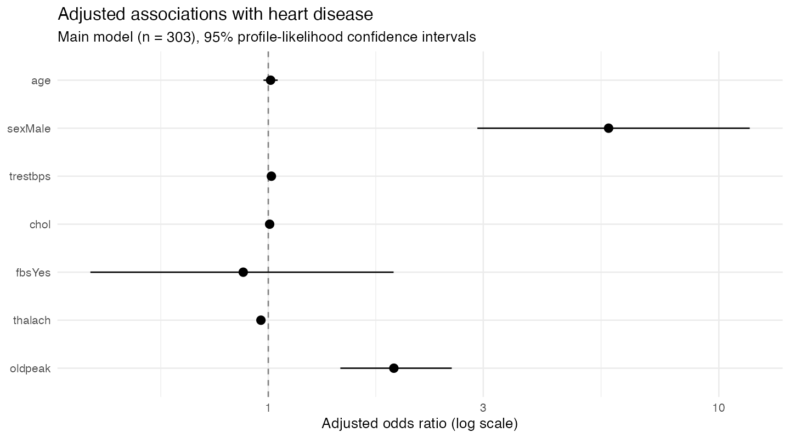
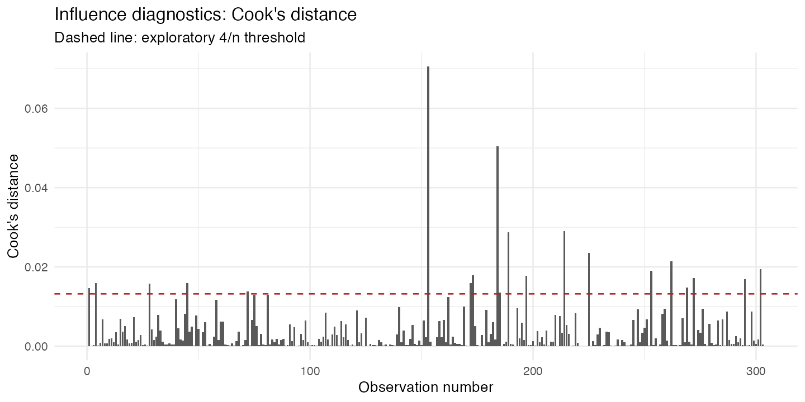
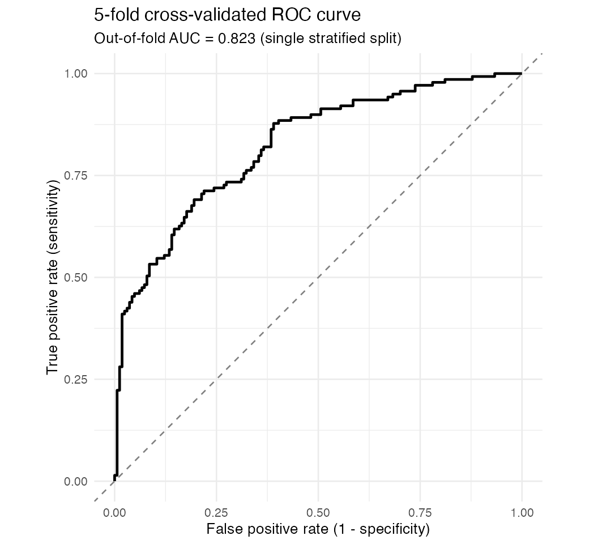

```{r setup, include=FALSE}
# Render from the project's root directory.
# The source script rebuilds all intermediate tables and figures.
stopifnot(file.exists("R/analysis.R"), file.exists("data/heart.csv"))
source("R/analysis.R", local = TRUE)
fmt <- function(x, digits = 3) formatC(x, digits = digits, format = "f")
```

> **Portfolio research exercise.** This is an independently documented, secondary analysis of the publicly available UCI Cleveland Heart Disease dataset. It is **not** a clinical risk tool or a causal study. The dataset contains 303 records and is distributed by the UCI Machine Learning Repository under CC BY 4.0, with attribution provided in the references.

# Abstract

**Background.** Cardiovascular disease data can provide a useful illustration of multivariable logistic regression, interpretable effect estimates, data-quality checks, and internal validation.

**Objective.** To explore associations between seven clinical characteristics and the presence of heart disease in the Cleveland dataset and to examine the stability and apparent discrimination of the fitted model.

**Methods.** The outcome was dichotomised as disease absent (`target = 0`) or present (`target = 1–4`). A multivariable logistic regression model included age, sex, resting blood pressure, serum cholesterol, fasting blood sugar category, maximum achieved heart rate, and exercise-induced ST depression (`oldpeak`). Adjusted odds ratios (ORs) were reported with 95% profile-likelihood confidence intervals. Cook's distances informed an *exploratory* sensitivity analysis. Discrimination was assessed with apparent AUC and a single stratified five-fold cross-validation.

**Results.** The primary model included `r nrow(heart_model)` observations, including `r sum(heart_model$heart_disease == 1)` with disease present. Male sex had an adjusted OR of `r fmt(primary_or$OR[primary_or$variable == 'sexMale'],2)` (95% CI `r fmt(primary_or$CI95_low[primary_or$variable == 'sexMale'],2)`–`r fmt(primary_or$CI95_high[primary_or$variable == 'sexMale'],2)`). The apparent AUC was `r fmt(auc_apparent)`; out-of-fold AUC was `r fmt(auc_cv)`. Excluding observations above the exploratory Cook's distance threshold materially changed several adjusted ORs.

**Conclusion.** The exercise demonstrates the use and interpretation of logistic regression, but results are associative, sensitive to certain influential observations, and not externally validated.

# Background and objective

The Cleveland Heart Disease dataset is widely used to demonstrate classification and statistical modelling of clinical data. The original outcome has five categories (0–4), frequently recoded to a binary indicator of disease presence (1–4) versus absence (0). The present exercise aims to interpret **adjusted associations**, rather than to establish clinical or causal effects.

The analysis asks: *Which of the selected patient characteristics are associated with the odds of heart disease, after adjusting for the other included characteristics?* A secondary objective is to assess how influence diagnostics and internal validation affect interpretation.

# Data and preprocessing

## Source and outcome

Data: **UCI Machine Learning Repository, Heart Disease (Cleveland processed subset)**. The source contains `r nrow(heart)` rows and a set of clinical attributes. The downloaded `heart.csv` in this repository is a re-formatted version with column headers; the original `target` coding is preserved.

The binary outcome was defined as:

$$
Y_i = \begin{cases}
0, & \text{if } \mathrm{target}_i=0,\\
1, & \text{if } \mathrm{target}_i \in \{1,2,3,4\}.
\end{cases}
$$

```{r outcome-table}
knitr::kable(target_summary, col.names = c("Heart disease (0 = absent, 1 = present)", "Patients", "%"),
             caption = "Outcome distribution in the full dataset.")
```

## Data-quality checks

Question marks in the original `ca` and `thal` fields were interpreted as missing data. There were `r sum(quality$missing_n)` missing cells in these two variables combined; the chosen seven-predictor model did **not** use either variable. All `r nrow(heart_model)` records were therefore retained in the primary analysis. The preprocessing step checked outcome and categorical-variable codings before model fitting.

```{r missingness-table}
knitr::kable(subset(quality, missing_n > 0),
             col.names = c("Variable", "Missing cells"),
             caption = "Variables with missing values in the source dataset.")
```

## Predictors and interpretation units

The following explanatory variables were used for this educational analysis:

| Predictor | Model representation | Comparison represented by the OR |
|:--|:--|:--|
| Age (`age`) | Continuous | One additional year |
| Sex (`sex`) | Categorical | Male versus female (reference) |
| Resting blood pressure (`trestbps`) | Continuous | +1 mmHg |
| Serum cholesterol (`chol`) | Continuous | +1 mg/dL |
| Fasting blood sugar (`fbs`) | Categorical | Greater than 120 mg/dL versus not (reference) |
| Maximum heart rate (`thalach`) | Continuous | +1 beat/minute |
| Exercise-induced ST depression (`oldpeak`) | Continuous | +1 unit |

Variables were selected as a manageable, interpretable demonstration of multivariable regression, **not** through a formally prespecified clinical variable-selection protocol. Continuous predictors were modelled linearly on the log-odds scale; this assumption was not formally evaluated here.

# Statistical methods

## Primary logistic regression

A multivariable binary logistic regression was fitted using the binomial family and logit link:

$$
\operatorname{logit}\!\left[\Pr(Y_i=1\mid X_i)\right]
=\beta_0+\beta_1\,\mathrm{age}_i+\beta_2\,I(\mathrm{male}_i)
+\beta_3\,\mathrm{trestbps}_i+\beta_4\,\mathrm{chol}_i
+\beta_5\,I(\mathrm{fbsYes}_i)+\beta_6\,\mathrm{thalach}_i
+\beta_7\,\mathrm{oldpeak}_i.
$$

The adjusted OR for a one-unit change or the specified category comparison was calculated as $\exp(\hat\beta_j)$. The 95% CIs were derived from **profile likelihood** (`confint()` in R) and exponentiated. Two-sided p-values in the output are Wald tests from `summary(glm(...))`.

The model is **associational**. In particular, an OR should not be interpreted as a relative risk, nor does statistical significance demonstrate causation.

## Influence and sensitivity

Cook's distance was computed for all observations. A threshold of $4/n$ was used as an **exploratory flag**, not a rule for deleting erroneous records. To examine sensitivity, the same model was refitted after excluding flagged observations. This deliberately restricted sample may differ systematically from the full sample; its estimates are *not* preferred over the primary results.

## Discrimination and internal validation

The area under the receiver operating characteristic curve (AUC) was computed from predicted probabilities using the rank-based Mann–Whitney relationship. Apparent AUC uses predictions from the model fitted on the same records.

To obtain out-of-fold predictions, a **single, stratified five-fold cross-validation** was carried out with seed 2026. The model was refitted on four folds and predictions generated for the held-out fold, repeated across all five folds. The resulting pooled out-of-fold AUC measures internal discrimination for this split only. There was **no external validation** or assessment of model calibration.

# Results

## Adjusted associations

```{r main-table}
main_display <- subset(primary_or, variable != "(Intercept)")
main_display <- data.frame(
  Predictor = main_display$variable,
  `Adjusted OR` = fmt(main_display$OR, 3),
  `95% CI lower` = fmt(main_display$CI95_low, 3),
  `95% CI upper` = fmt(main_display$CI95_high, 3),
  `Wald p-value` = format.pval(main_display$p_value, digits = 3, eps = 0.001),
  check.names = FALSE
)
knitr::kable(main_display,
             caption = "Main multivariable model; 303 patients. ORs are conditional on the other model covariates.")
```

Male sex, higher cholesterol, lower achieved maximum heart rate, and higher `oldpeak` values were associated with the disease outcome at the conventional 5% threshold in the primary adjusted model. Age, resting blood pressure and elevated fasting blood sugar were not statistically significant in this model.

For example, the adjusted OR for male versus female was `r fmt(primary_or$OR[primary_or$variable == 'sexMale'], 2)` (95% CI `r fmt(primary_or$CI95_low[primary_or$variable == 'sexMale'], 2)`–`r fmt(primary_or$CI95_high[primary_or$variable == 'sexMale'], 2)`). This describes **odds**, not a `r fmt(primary_or$OR[primary_or$variable == 'sexMale'], 2)`-fold probability of disease. Differences in covariate distributions, selection, and residual confounding may also affect these results.

{#fig-forest width=95%}

## Influence diagnostics

The exploratory threshold was $4/303 \approx$ `r fmt(cook_threshold, 4)`. There were **`r sum(flag)`** flagged observations. The main model retained all 303 records. An additional model used `r nobs(model_sens)` records after omitting flagged observations **solely for sensitivity assessment**.

{#fig-cook width=95%}

## Sensitivity analysis

```{r sensitivity-table}
sens_display <- subset(or_comparison, variable != "(Intercept)")
sens_display <- data.frame(
  Predictor = sens_display$variable,
  `Main OR` = fmt(sens_display$OR_primary, 3),
  `Main 95% CI` = paste0("[", fmt(sens_display$CI95_low_primary, 2), ", ", fmt(sens_display$CI95_high_primary, 2), "]"),
  `Sensitivity OR` = fmt(sens_display$OR_sensitivity, 3),
  `Sensitivity 95% CI` = paste0("[", fmt(sens_display$CI95_low_sensitivity, 2), ", ", fmt(sens_display$CI95_high_sensitivity, 2), "]"),
  check.names = FALSE
)
knitr::kable(sens_display,
             caption = "Primary versus exploratory influence-restricted model; the main model remains preferred.")
```

The OR for male sex increased from `r fmt(primary_or$OR[primary_or$variable == 'sexMale'], 2)` to `r fmt(sensitivity_or$OR[sensitivity_or$variable == 'sexMale'], 2)`, indicating that the estimated **magnitude** is sensitive to the restriction. Elevated `oldpeak` also showed a meaningful change. This should temper strong substantive claims even where conventional p-values remain small. Because inclusion in the sensitivity subset depends on observed influence, it is not an unbiased substitute for the full sample.

## Discrimination

```{r auc-table}
auc_table <- data.frame(
  Assessment = c("Apparent AUC (training sample)",
                 "Internal five-fold cross-validated AUC"),
  AUC = c(fmt(auc_apparent), fmt(auc_cv))
)
knitr::kable(auc_table, caption = "Discrimination of the fitted logistic regression model.")
```

The apparent AUC was **`r fmt(auc_apparent)`**, and the pooled out-of-fold AUC from one five-fold cross-validation was **`r fmt(auc_cv)`**. An AUC is a ranking measure, not classification accuracy; it cannot be interpreted as the proportion of patients classified correctly. The small difference between the two metrics is encouraging but does not guarantee performance on independent populations.

{#fig-roc width=78%}

# Discussion

This analysis demonstrates the full workflow for a small epidemiological modelling exercise: verification of variable encodings, explicit construction of a binary outcome, multivariable estimation, ORs and uncertainty intervals, diagnostic checks, sensitivity analysis, and out-of-fold discrimination.

The pattern of associations in the fitted model is compatible with differences in disease status across the measured characteristics, **conditional on the included covariates**. However, no causal inference is justified. The influential-observation analysis is especially informative: excluding the 20 flagged observations yielded materially different adjusted ORs, even though these observations cannot be assumed to be invalid.

## Limitations

1. **Selection and generalisability.** The Cleveland dataset is an historical clinical sample, not a representative population survey. Its estimates should not be generalised directly to current community populations.
2. **Observational and associational design.** Residual confounding, selection effects, and omitted predictors may explain part of the associations.
3. **Model form.** Continuous covariates were assumed to have linear log-odds relationships; potential non-linearity and interactions were not formally tested in this exercise.
4. **Variable selection.** The reduced seven-predictor specification was chosen for pedagogical interpretability; it is not a comprehensive clinical risk model.
5. **Influential observations.** Sensitivity to exploratory exclusions limits confidence in the stability of some effect magnitudes. Cook's distance does not itself identify incorrect observations.
6. **Validation.** The cross-validated AUC is from one stratified five-fold split. There was no repeated or external validation, no formal calibration assessment, and no test of clinical utility.
7. **Outcome interpretation.** The binary outcome recodes the original 0–4 classification and should be understood within the dataset's original clinical definitions.

# Conclusion

In this reproducible R analysis, several measured characteristics were associated with heart disease status in the UCI Cleveland dataset. The primary model showed promising apparent and internally cross-validated discrimination, while influence-based sensitivity analyses revealed instability in the magnitude of some adjusted ORs. This underscores the importance of reporting **effect estimates, uncertainty, diagnostics, and validation limitations together**, rather than focusing on significant p-values alone.

# Reproducibility and data attribution

All tables and figures are regenerated by the single script `R/analysis.R`, which imports `data/heart.csv` and writes outputs under `outputs/tables/` and `outputs/figures/`. The Quarto report executes that script from the project root, then displays its results.

To reproduce in RStudio, use the project root as the working directory and run:

```r
source("R/analysis.R")
quarto::quarto_render("report.qmd")
```

**Dataset citation:** Janosi, A., Steinbrunn, W., Pfisterer, M., & Detrano, R. (1989). *Heart Disease* [Dataset]. UCI Machine Learning Repository. https://doi.org/10.24432/C52P4X. Dataset licensed **CC BY 4.0**; attribution required. Original dataset: https://archive.ics.uci.edu/dataset/45/heart+disease.

This portfolio report is an educational secondary analysis and is not affiliated with UCI or the original dataset investigators.
